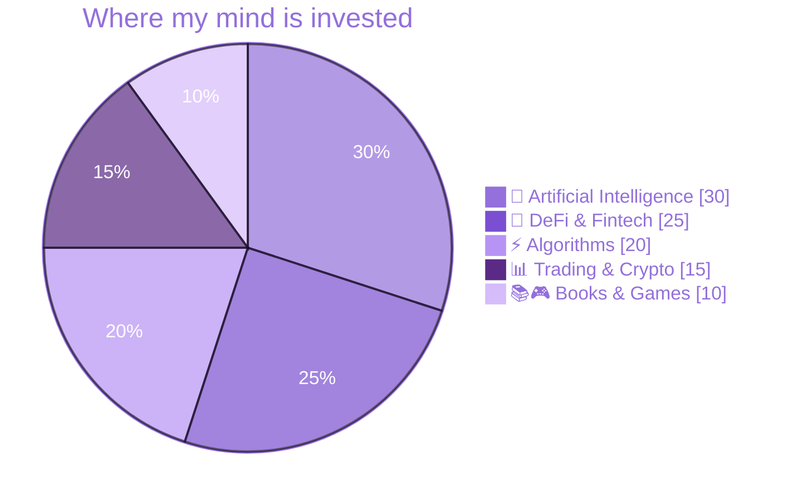

<!-- ═══════════════════════════ HEADER ═══════════════════════════ -->
<div align="center">


<a href="https://github.com/DreyDreamer17">
  
</a>

<br/>

<!-- ─── LIVE TICKER ─── -->


<sub><i>market is open · volatility is a feature · not financial advice</i></sub>

</div>

<br/>

<div align="center">

───────────────── ✦ ─────────────────

### *"Your mind can free you, or trap you."*

───────────────── ✦ ─────────────────

</div>

<br/>

<!-- ═══════════════════════════ 01 · ABOUT ═══════════════════════════ -->
## ◈ 01 · `whoami.sol`

```solidity
// SPDX-License-Identifier: MIT
pragma solidity ^0.8.24;

/// @title  DreyDreamer17
/// @notice CS student building where technology meets finance.
/// @dev    Believes code can make economic opportunity more inclusive.
contract DreyDreamer17 {

    string public constant role    = "Computer Science Student";
    string public constant mission = "Reshape financial systems with code";
    string public constant motto   = "Your mind can free you, or trap you.";

    string[] public interests = [
        "Artificial Intelligence",
        "Decentralized Finance",
        "Algorithmic Trading",
        "Crypto Markets"
    ];

    struct OffChain { string reading; string gaming; }
    OffChain public afk = OffChain("novels that expand perspectives", "strategy games");

    mapping(string => string) public stack;

    constructor() {
        stack["languages"] = "Python, JavaScript, Java, C++";
        stack["ai_ml"]     = "TensorFlow, PyTorch, Pandas, NumPy";
        stack["web3"]      = "Solidity, Ethereum, Web3.js";
        stack["tooling"]   = "Git, Docker, VS Code";
    }

    function collaborate(string calldata idea) external pure returns (string memory) {
        return string.concat("Let's build ", idea, " together.");
    }
}
```

<br/>

<!-- ═══════════════════════════ 02 · ALLOCATION ═══════════════════════════ -->
## ◈ 02 · Portfolio Allocation

<table>
<tr>
<td width="55%">



</td>
<td width="45%">

**🤖 AI** <br/>
<sub>Exploring the frontiers of machine learning</sub>

**🏦 DeFi & Fintech** <br/>
<sub>Building the future of decentralized finance</sub>

**⚡ Algorithms** <br/>
<sub>Crafting efficient solutions to hard problems</sub>

**📊 Trading & Crypto** <br/>
<sub>Navigating the volatile world of digital assets</sub>

**📚🎮 Books & Games** <br/>
<sub>Where strategy and new perspectives come from</sub>

</td>
</tr>
</table>

<br/>

<!-- ═══════════════════════════ 03 · HOLDINGS ═══════════════════════════ -->
## ◈ 03 · Holdings

<div align="center">


</div>

<details>
<summary><b>📂 View full position breakdown</b></summary>
<br/>

| Asset Class | Positions |
|:--|:--|
| **💻 Languages** |     |
| **🧠 AI / ML & Data** |     |
| **⛓️ Blockchain & Web3** |    |
| **🛠️ Tooling** |    |

</details>

<br/>

<!-- ═══════════════════════════ 04 · POSITIONS ═══════════════════════════ -->
## ◈ 04 · Open Positions

| Position | Side | Conviction | Status |
|:--|:--:|:--|:--:|
| 🏦 DeFi protocols & smart contracts | 🟢 `LONG` | `▰▰▰▰▰▰▰▰▰▱` 90% | 🔨 Building |
| 📈 Trading algorithms & market analysis tools | 🟢 `LONG` | `▰▰▰▰▰▰▰▰▱▱` 80% | ⚙️ Developing |
| 🧠 Advanced machine learning algorithms | 🟢 `LONG` | `▰▰▰▰▰▰▰▱▱▱` 70% | 🌱 Learning |
| 🌐 Open-source fintech projects | 🟢 `LONG` | `▰▰▰▰▰▰▱▱▱▱` 60% | 🤝 Contributing |
| ☕ Writing code without coffee | 🔴 `SHORT` | `▰▱▱▱▱▱▱▱▱▱` 10% | 💀 Liquidated |

<br/>

<!-- ═══════════════════════════ 05 · PERFORMANCE ═══════════════════════════ -->
## ◈ 05 · Performance Report

<div align="center">


</div>

<!-- Optional: uncomment after adding the snake workflow (see setup notes)
<div align="center">
<picture>
  <source media="(prefers-color-scheme: dark)" srcset="https://raw.githubusercontent.com/DreyDreamer17/DreyDreamer17/output/github-snake-dark.svg" />
  
</picture>
</div>
-->

<br/>

<!-- ═══════════════════════════ 06 · OFF-CHAIN ═══════════════════════════ -->
## ◈ 06 · Off-Chain Activity

<table>
<tr>
<td align="center" width="33%">

### 📚
**Reading** <br/>
<sub>Novels and books that expand perspectives. Every page is a free alpha leak.</sub>

</td>
<td align="center" width="33%">

### 🎮
**Gaming** <br/>
<sub>Strategy over reflexes. Thinking three moves ahead, on and off the board.</sub>

</td>
<td align="center" width="33%">

### 🕯️
**Charting** <br/>
<sub>Reading candles, spotting patterns, and following DeFi and Web3 innovation.</sub>

</td>
</tr>
</table>

<br/>

<!-- ═══════════════════════════ 07 · CONNECT ═══════════════════════════ -->
## ◈ 07 · Open a Position With Me

<div align="center">

I'm always up for collaborating on **AI**, **fintech**, **DeFi**, or anything that pushes <br/>
the boundaries where technology meets finance. Let's build something worth holding.

<br/>

[](https://github.com/DreyDreamer17)
[](https://linkedin.com/in/YOUR_HANDLE)
[](https://x.com/YOUR_HANDLE)
[](mailto:YOUR_EMAIL)

</div>

<br/>

<!-- ═══════════════════════════ FOOTER ═══════════════════════════ -->
<div align="center">

```diff
+ tx confirmed · block #∞ · gas: ☕☕☕
+ "Building the future, one algorithm at a time."
```


</div>
